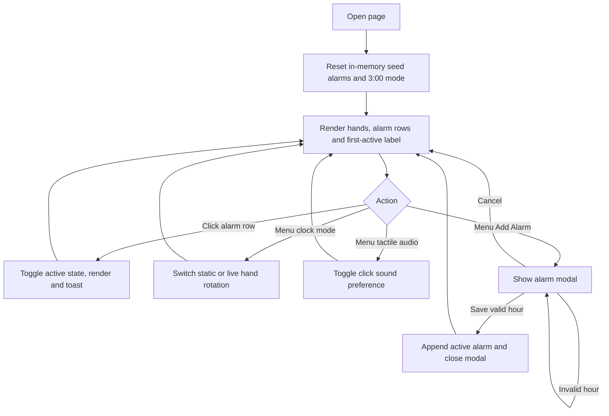

# Alarm Clock — app flow

[Requirements](requirements.md) · [Testing](../TESTING.md)

The menu closes after choosing its clock, audio, or Add Alarm action; clicking outside also dismisses it. Live Time only updates the analog hands. It does not activate scheduled alarm behavior.

Saving an alarm changes list order and the first-active label. Disabling all rows shows All alarms disabled. Reloading loses additions/toggles/mode and restores seed state.

No later screen, ringing event, notification permission request, or server submission follows these interactions. See the requirements document for the current minute-validation and keyboard-access gaps.
