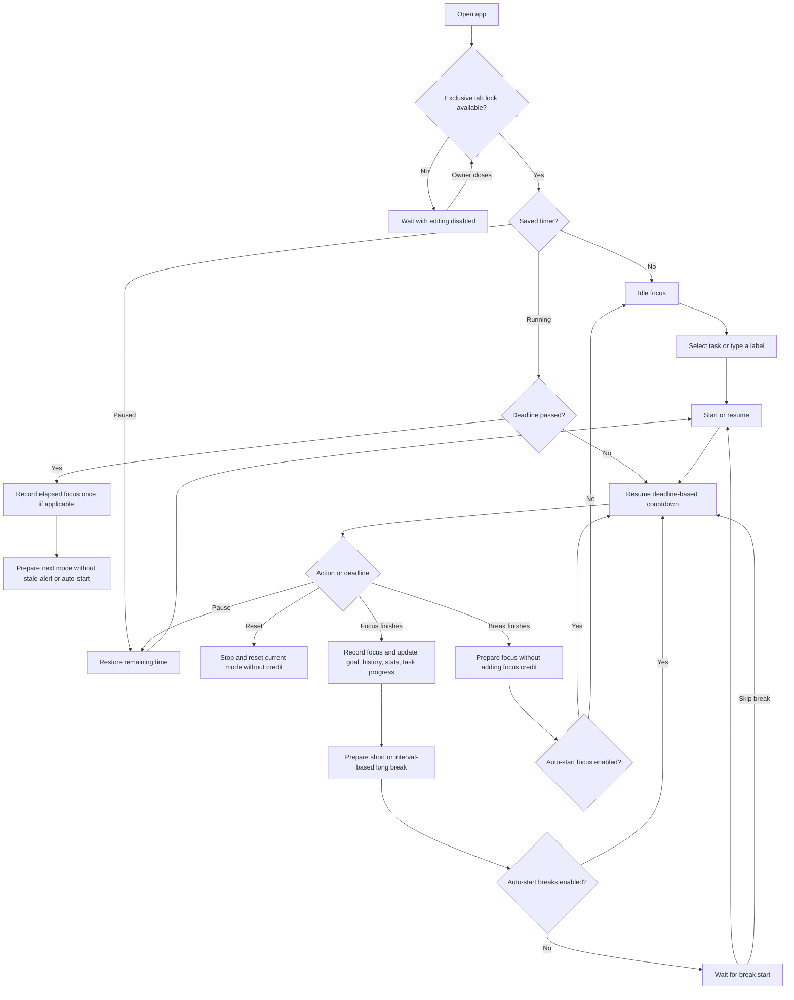
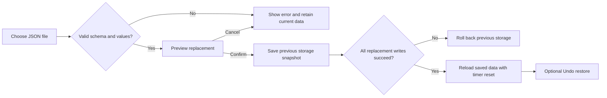

# Pomodoro Timer — app flow

See [requirements](requirements.md) for constraints and [testing](../TESTING.md) for verification.

## Tab ownership

The first tab to acquire the browser lock initializes the app. Other tabs show a waiting notice and do not initialize application scripts or read stale data into an editable view. Closing the owner automatically admits the next waiting tab, which restores current saved tasks, preferences, history, and the timer deadline. Refresh queues behind an already waiting tab. Missing/denied lock support shows a retry message instead of silently allowing two writers. Backgrounding does not surrender ownership.

## Main session

The running mode determines whether F represents focus or break. Skip break also works during a running break and starts focus immediately. Space/R use the same session actions as the dial/reset controls.

## Returning after inactivity

An open running page derives remaining seconds from its deadline after background throttling or suspension. Returning to a visible page, focusing the window, or receiving a supported resume event triggers an immediate quiet reconciliation. If a regular callback discovers a completion more than one minute late, it records the original focus session once at its original deadline, prepares the next mode idle, and avoids stale alerts or automatic cycles. It never invents additional sessions for time spent away. A paused timer stays paused with the same remaining time.

## Task queue and attribution

1. Open cards and add a task with its daily focus target.
2. Select its name or Focus. The field beneath the timer displays that task; an explicit selection reveals the field if it was hidden.
3. Start focus. Switching tasks changes the eventual attribution without restarting elapsed time. Free-form typing clears the queue selection while retaining the queued task itself.
4. Finishing focus adds a history entry with the current label/ID. Completing a task manually only changes its queue state and plays its reward.
5. Completed tasks move into Completed; selected idle completion picks the next pending task. Clear completed removes all done queue items, with a single persisted Undo clear operation.
6. Edit/delete/complete controls remain protected for the selected task during active or partially elapsed focus.

## Profile and routines

Open Edit Profile → choose Profile, Timer, Notifications, or Backup & Restore. Tab switches keep drafts. In Timer, choose a built-in routine or enter durations/cycle and Save routine under a name. Save profile commits all draft changes; Cancel discards them. New durations replace an untouched idle timer, but a running or partially elapsed timer keeps its current duration until the next mode/reset.

The one-minute cue is opt-in. Crossing the final-minute boundary consumes its once-per-session marker, including when muted or recovering a timer. Preview cue only previews the sound.

## Mini and audio

Mini opens from the timer controls. A supported Picture-in-Picture window stays on top; otherwise it is an ordinary small popup. Both views act on the same timer and task state. Closing Mini does not stop the session. Returning to the main timer closes Mini; leaving the main page closes its mini window.

Ambient Play starts a local recording or generated white noise. Hiding cards or changing tabs does not pause audio. Pause stops playback; choosing another sound while playing switches the source. Opening the optional YouTube alternative pauses in-app audio. Leaving/reloading the page ends playback and does not auto-resume it.

## Layout and history

Desktop cards start in the drawer or restore their saved floating positions. Dragging/keyboard movement detaches them; the last used card comes to the front. Reset layout returns all cards. Mobile uses an explicit Show cards button and a scrollable stack, with the timer as the primary view.

Calendar selection/hover/focus shows per-day completed work. Weekly stats and daily beads use recorded focus history, rather than manual task completion.

## Pending completion

If saving a completed focus fails, stop its countdown at zero and keep its session ID, original deadline, and in-memory history entry. Show the storage warning and retry hint. The user can export that entry with a backup, free browser storage, and press the timer to retry. Only a successful history save prepares the next phase. Reload retries a saved pending marker; a pre-transition timer against already-recorded history produces no duplicate session. Task reassignment, Reset, and Restore cannot silently replace that pending completion.

## Backup replacement

## Restore recovery and damaged saves

Before Restore or Undo changes any key, persist a complete before-image journal. Successful replacement removes the journal. Failure rolls back; if rollback cannot finish, retain the journal, stop the timer and block editing. On next startup the tab owner loads the storage helper first and completes recovery before the app initializes. A failed/damaged recovery or corrupt saved JSON shows the recovery screen instead of loading defaults over old data. Download recovery copy exports the original stored strings for manual repair; Try again reloads after the underlying issue is resolved.

## Keyboard and assistive interaction

Focus the timer to read its action, current phase and remaining time. Activating it changes its pressed state and the phase/state live message; ordinary second ticks do not replace that message. The live region stays outside the optional current-task field. Mute exposes whether timer sounds are muted.

Keyboard users open the drawer with its button. Tab enters the selected calendar date, arrow keys move by day/week (including month boundaries), and Home/End choose the week's Monday/Sunday. Escape first dismisses an open calendar popup; another Escape closes the drawer. Queue focus/select/edit/delete operations restore a usable control after rows are rebuilt; closing the task editor returns to Edit or the new-task input if that action no longer exists.

Reduced-motion preferences remove CSS transitions/animations, supplementing the existing JavaScript reward-animation guard. Coarse-pointer and narrow layouts enlarge primary controls, wrap the timer toolbar/footer, and keep the drawer opt-in.

## Build and release flow

Run `npm run check` from this project directory: parse source/tooling/tests → run all repository regression suites → create an allowlisted `dist/` folder. Preview that folder over localhost, then finish the manual release checks in [deployment](deployment.md). The configured GitHub workflow repeats checks/build on matching changes; publication is a separate action. Local CSS loads before component styling; the optional sound library is deferred so it does not block parsing the timer UI.
