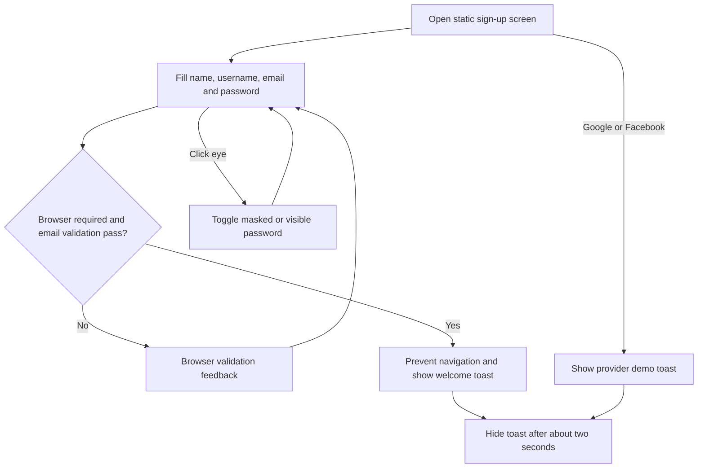

# Sign Up — app flow

[Requirements](requirements.md) · [Testing](../TESTING.md)

Form submission keeps the entered fields on the same page. It does not clear them, create an account, log in, request OAuth consent, or send a registration request. Provider buttons work independently of native form validation because they are not submit buttons.

A later toast replaces the previous toast and restarts its hide timer. Reloading recreates the page; the app has no persistence logic. A browser may separately restore/autofill form values, which is not an app-level account feature.
