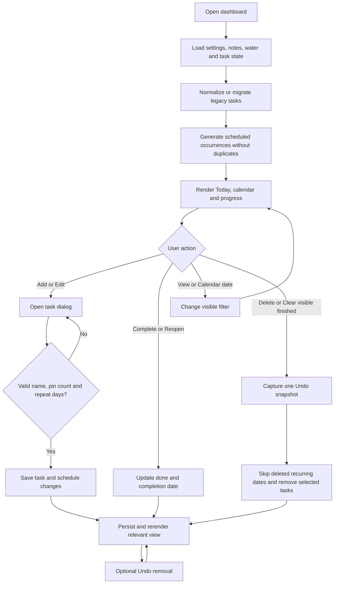

# To do list — app flow

[Requirements](requirements.md) · [Testing](../TESTING.md)

## Planning and recurrence

1. Add opens a fresh dialog. Default due date follows the selected calendar date, Tomorrow in Upcoming, or Today otherwise. No date clears the date for nonrepeating work.
2. Choose priority/pin and optional daily, weekly, or custom-weekday repetition. Custom requires at least one weekday; a fourth pinned item is rejected.
3. Save commits; Cancel or closing the dialog discards the form. A task added outside the current filter can cause the view/date to adjust so the new task can be found.
4. Scheduled occurrences appear for the current month/near-future horizon when the app evaluates that range. Repeated visits must not duplicate them.
5. Edit an occurrence through its options menu. Text/date edits apply to that occurrence; changing its repeat pattern updates future scheduling.
6. Delete an occurrence to skip that date. Stop repeating deactivates the series and retains completed/past/current work while removing future uncompleted occurrences. The latest removal can be undone before reload.

## Completing and organizing

A completion toggles its done state, records today's completion date, saves, optionally sounds, and updates progress. Reopening clears the completion date. Finishing all current daily tasks briefly celebrates. Clearing visible completed items preserves their contribution to the daily ledger. The latest Undo merges removed work back without deleting tasks created afterward or replacing notes/settings.

Pinned tasks render before unpinned ones. Reorder actions operate among visible peers in the same group. To change groups, pin/unpin first.

## Calendar and filters

Today includes overdue and undated pending work. Upcoming excludes completed work. Completed shows done tasks across dates. Selecting a calendar date instead shows tasks due on that date. Show all clears that date filter; calendar Today returns the month and task view to local Today.

## Notes, settings, water, and day change

Notes save directly as typed. Settings open a draft; Save updates personal text, water goal, and sound, while Cancel leaves saved values unchanged. Sound preview uses the current draft choice/volume without submitting settings.

Water +/- changes the current day in 250 mL steps. A local day change refreshes water, calendar, occurrences, and summaries. Clock updates occur every second and when the tab becomes visible again; there is no server-side midnight job.

## Backup and restore

Open Personal settings → Backup & restore. Download backup saves the current dashboard as JSON. Choose backup validates its format, size (up to 2 MB), task identities, schedules, and settings, then shows the task/schedule/note counts before any replacement. Restore this backup keeps the existing dashboard as a recovery copy, restores the chosen data, and returns to Today. Undo last restore in the same settings section recovers that previous dashboard, including after reload. Notes and settings drafts are independent of ordinary task Undo.

## Weekly review

Select Review ↗ beside the daily progress ring. The dialog opens on the local Monday–Sunday week; browse previous saved weeks or return to This week. Finished totals include cleared work from retained daily records. The carryover list shows tasks still pending now, due by the selected Sunday, plus undated work. Daily bars show saved checklist progress and water intake. Unrecorded days use a dash and future days are not counted. Water-target changes apply to today’s record; previous dates keep their saved targets. Escape or Close returns focus to the Review button.
