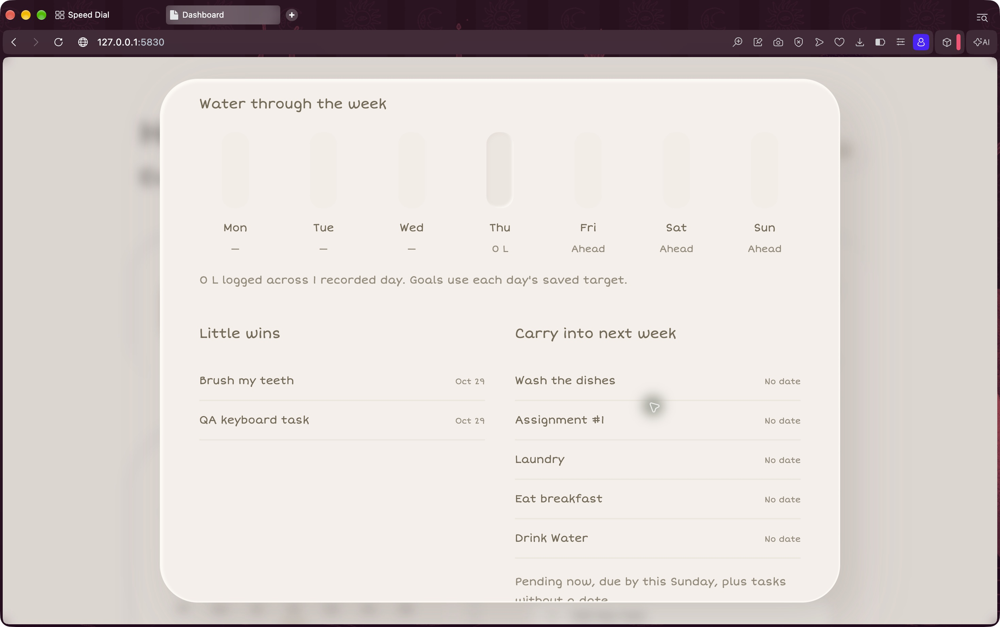

# Manual QA — 2026-10-29

[Testing guide](../TESTING.md) · [Requirements](requirements.md)

## Environment and method

Opera 138.0 on macOS 27.0.1. Native Opera window, keyboard and accessibility-tree inspection, with Short Stack visibly loaded. The QA copy was served at `http://127.0.0.1:5830/`, a separate origin from the user's dashboard. Only disposable QA tasks and notes were changed. Chrome and production browser storage were not used.

The browser started at 110% zoom. Desktop checks used 100%; high-zoom checks used the native Opera zoom control, which reported **200%**. Responsive mode reported **390 × 844**. Responsive emulation is not a physical-phone test. The original 110% zoom was restored and the temporary QA tab was closed after testing.

## Observed results

| Check | Result | Evidence |
| --- | --- | --- |
| Add by keyboard | Pass | Add opens with task-name focus. A typed QA task saved with Enter; focus returned to Add task. |
| Task options and pinning | Pass | Tab reached options; Space opened the popover. Tab/Space pinned the task. Focus remained on its options button after rerender. Escape dismissed the popover and restored focus. |
| Keyboard completion | Pass | Space completed the QA task; its pressed state and daily progress changed from 1/7 to 2/7. Weekly review showed two finished tasks. |
| Delete and Undo | Pass | In the narrow layout, the QA task was deleted through the popover. Tab navigation reached Undo and Space restored it, including its completed state. |
| Notes and refresh | Pass | Typed a QA note using the keyboard, refreshed the real Opera page, and observed the same note with Saved status. |
| Settings validation and Cancel | Pass | Native validation rejected water target 0 with a minimum-250 message and focus on the target. Cancel discarded the draft name/target; saved Tin and 2000 mL remained. |
| Long task input and recurrence validation | Pass | A long paste was constrained to 80 characters. Selected weekdays showed the seven controls. Saving with no weekday displayed Choose at least one weekday and did not create the task. |
| Desktop at 200% zoom | Pass | Native zoom popup reported 200%. Weekly review and task dialog stayed within the window. Page Down scrolled to lower content and footer controls, with visible keyboard focus. |
| Narrow layout | Pass (emulated) | At 390 × 844, cards stacked, options remained visible, the task menu stayed within the viewport, and Add task/Review remained reachable. Keyboard navigation scrolled to Notes below the calendar. |
| Weekly review semantics | Pass for inspected tree | The accessibility tree exposed full weekday/date descriptions, checklist counts, water amount/target, no-record and future-day descriptions. Actual spoken screen-reader behavior was not tested. |
| Weekday checkbox names | Fixed | Native accessibility names were split as M onday, T uesday, etc. Added explicit full weekday labels to each checkbox. Regression test checks all seven exact names. |

## Additional instrumented checks

These are separate from the manual observations above:

- Opera touch emulation: tap task options, edit, select a weekday, cancel, complete a task and open/close weekly review.
- Reduced-motion preference: celebration remains visible as feedback but has no CSS animation.
- America/New_York daylight-saving fall-back: the 25-hour local day is handled; the repeated 01:00 hour does not reset water/progress. Water resets at the next local midnight and the previous day's intake remains in history.
- Existing 580/581 px breakpoint and backup/restore regression checks remain automated, rather than newly certified as native manual checks.

## Remaining manual checks

- Physical iOS/Android touch, virtual keyboard and browser-specific viewport behavior.
- Spoken VoiceOver/NVDA output and end-to-end screen-reader operation. Accessibility-tree inspection alone is not certification.
- Perceived sound quality on actual speakers/headphones. The native completion action produced an active-audio tab indicator; sound generation/mute behavior is covered by tests.
- Backup exchange with a different browser engine. Automated backup/restore uses isolated Opera profiles; Chrome was intentionally not used.

The full acceptance checklist in TESTING.md includes scenarios beyond this targeted manual pass. Keep unchecked items until all their subconditions have been manually executed; automated passes do not automatically check those boxes.

## Captured evidence

Native Opera at verified 200% zoom, scrolled to the review’s lower content:

